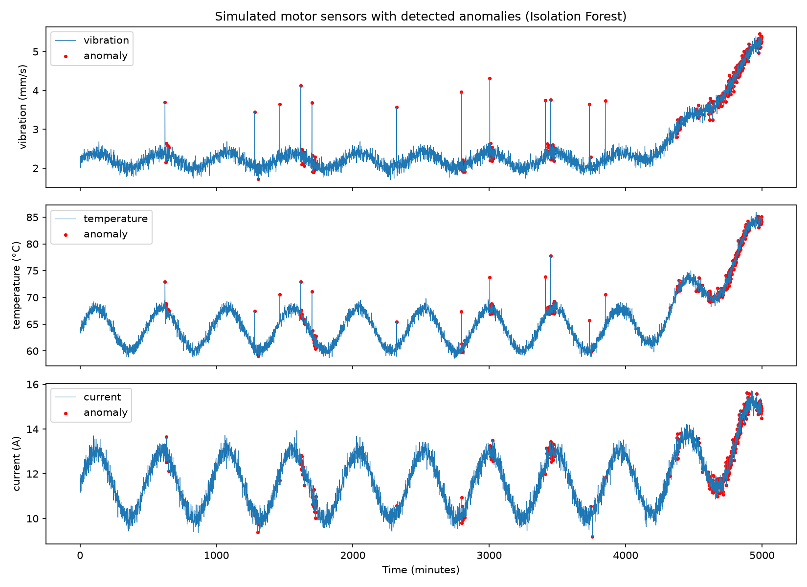
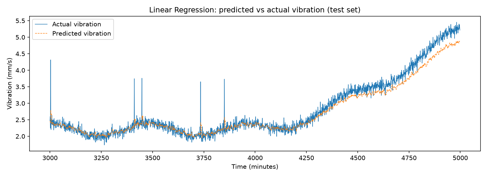
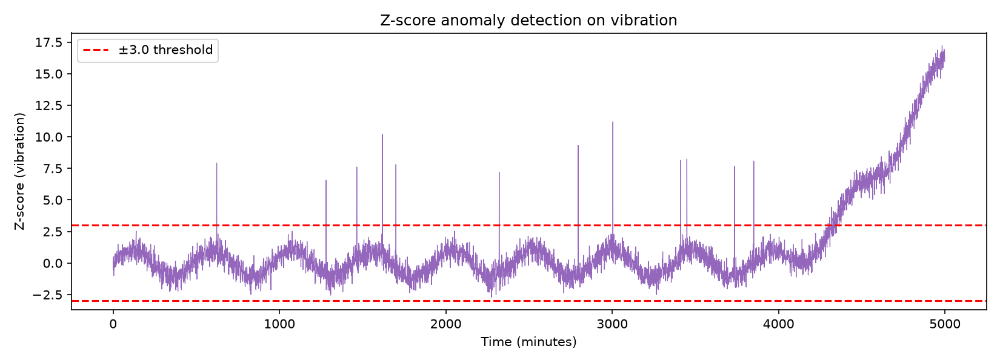

# Predictive Maintenance for Factory Motor

**AI for IoT: Capstone Project (Experiment 8)**
**Course Code:** 1211561
**College:** M.H. Saboo Siddik College of Engineering
**Department:** Computer Science and Engineering (IoT)
**Guide:** Fiza Shaikh

## Team

| Name | Roll No. |
|------|----------|
| Mohammed Nihal Shaikh | 241851 |
| Ayan Syed | 241860 |
| Arsh Qaseem | 241856 |
| Shoeb Sayed | 241835 |

## About the Project

Factory motors rarely fail without warning. Vibration, temperature and current usually rise slowly before a bearing or motor breaks down. This project predicts vibration trends for a motor and detects anomalies that indicate impending failure, using simulated IoT sensor data (software-only implementation).

## Pipeline

```
Simulated Sensors -> Preprocessing -> Prediction (Linear Regression)
-> Anomaly Detection (Isolation Forest + Z-score) -> Dashboard / Report
```

- **Sensors (simulated):** vibration (mm/s), temperature (°C), motor current (A), 5,000 readings at one per minute
- **Fault injection:** gradual bearing wear from minute 4,000, plus 12 random transient spikes
- **Preprocessing:** interpolation, 30-minute rolling mean and standard deviation, MinMax scaling
- **Prediction:** Linear Regression on the last 5 vibration readings to predict the next one
- **Anomaly detection:** Isolation Forest (all sensors) and Z-score (vibration), both trained on healthy data only
- **Output:** matplotlib plots and a Streamlit dashboard with a maintenance alert

## Results

Models were trained on minutes 0 to 3,000 and tested on minutes 3,000 to 5,000.

**Prediction (Linear Regression)**

| Metric | Value |
|--------|-------|
| RMSE | 0.205 mm/s |
| MAE | 0.146 mm/s |
| R² | 0.949 |

**Anomaly detection**

| Method | Precision | Recall | F1 |
|--------|-----------|--------|----|
| Isolation Forest | 0.792 | 0.407 | 0.538 |
| Z-score (vibration) | 0.976 | 0.995 | 0.986 |

Z-score worked best on this simulated fault. Isolation Forest missed the subtle early drift. The full discussion is in the project report.

### Plots







## Project Structure

```
.
├── pipeline.py          # simulation, preprocessing, models, plots
├── app.py               # Streamlit dashboard
├── requirements.txt     # Python libraries
├── outputs/             # generated plots and CSV
└── README.md
```

## How to Run

1. Install Python 3 and clone this repository:
   ```bash
   git clone https://github.com/Nikkusk80/motor-predictive-maintenance.git
   cd motor-predictive-maintenance
   ```
2. Install the libraries:
   ```bash
   pip install -r requirements.txt
   ```
3. Run the pipeline (prints the metrics and saves plots in `outputs/`):
   ```bash
   python pipeline.py
   ```
4. Start the dashboard:
   ```bash
   streamlit run app.py
   ```
   Open the link shown in the terminal (usually http://localhost:8501).

## Technologies Used

Python, NumPy, pandas, scikit-learn, matplotlib, Streamlit

## Limitations and Future Scope

- The data is simulated, so scores show agreement with the simulation rules, not real-world accuracy.
- Only one fault type (bearing wear) is modelled.
- Future work: real sensors (accelerometer, temperature and current sensors on an ESP32 or Raspberry Pi), an LSTM model, remaining-useful-life estimation, and alerts by SMS or email.
